<div align="center">

# 🌏 QGIS AI Agent Copilot

**让 QGIS 听懂自然语言 —— 基于 DeepSeek 原生多模态的 QGIS 智能 GIS 助手**

*An AI Copilot for QGIS: natural-language geoprocessing, remote sensing, OSM / GEE data acquisition and cartography.*

[](https://github.com/aboutqiguo/qgis-agent-plugin/releases)
[](https://qgis.org)
[](https://www.python.org)
[](https://platform.deepseek.com)
[](#-开发与测试)
[](#-协议与致谢)

[功能特性](#-核心特性) · [应用效果](#-应用效果展示) · [系统架构](#-系统架构) · [快速开始](#-快速开始) · [界面介绍](#-界面介绍) · [使用示例](#-使用示例) · [更新日志](#-更新日志)

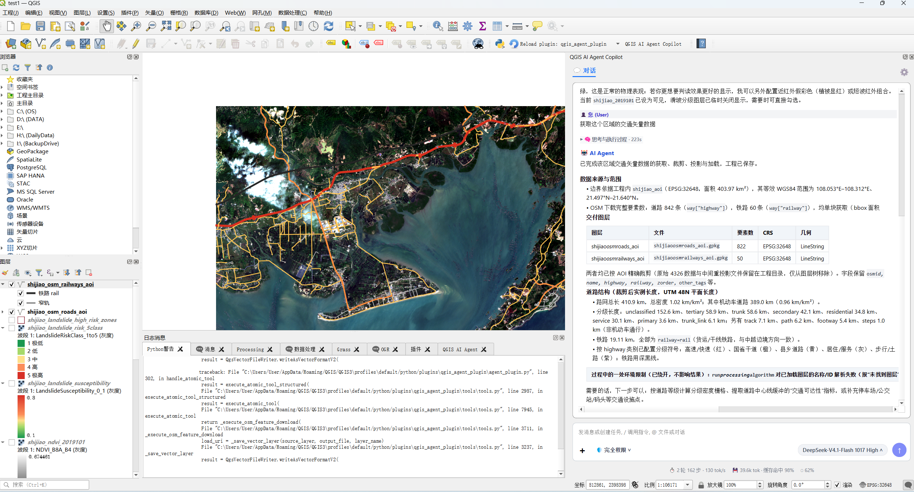

</div>

---

## 📖 项目简介

**QGIS AI Agent Copilot** 是一个运行在 QGIS 内部的智能体（Agent）插件。它把 **大语言模型（DeepSeek）**、**PyQGIS**、**QGIS Processing Toolbox（700+ 算法）**、**OpenStreetMap** 与 **Google Earth Engine** 串联起来，用户只需在侧边栏用中文描述任务，Agent 就会自动完成：

> 理解意图 → 拆解计划 → 选择工具 → 执行处理 → 校验结果 → 加载渲染 → 保存工程 → 汇报总结

与「让大模型写一段代码再手动粘贴」不同，本插件在 QGIS 中构建了完整的 **工具调用闭环**：64 个结构化原子工具、参数静态校验、PyQGIS 代码安全审查与自动修复、执行断点、结果核验与工程级记忆，尽可能让每一步都 **可执行、可验证、可恢复**。

> [!WARNING]
> **网络说明：Google Earth Engine（GEE）与 OpenStreetMap（OSM / Overpass / Nominatim）相关功能需要在可访问国际互联网的网络环境（VPN / 代理）下使用。**
> 在中国大陆网络环境下，未开启 VPN 时 GEE 认证、影像下载、Google Drive 同步以及 OSM 边界 / 路网 / 要素下载均可能超时或失败。DeepSeek 对话、本地栅格 / 矢量分析、Processing 算法调用不受影响。

---

## ✨ 核心特性

| 模块 | 能力 |
|---|---|
| 🧠 **自然语言 GIS 工作流** | 中文任务自动拆解为多步骤计划；支持计划审批、分步执行、断点续跑与失败诊断 |
| 👁️ **DeepSeek 原生多模态** | 无需第三方视觉平台，直接解析截图、地图画布与图片附件，并对出图排版进行视觉评审 |
| 🛰️ **遥感计算与影像解译** | 支持 NDVI / NDWI / MNDWI 等指数安全计算，集成掩膜统计与**机器学习样本构建、模型训练、精度验证与跨区域推理分割**全链路 |
| 🗺️ **OSM 矢量数据获取** | 行政边界、道路、铁路、建筑、POI、水系、土地利用；自动分块、去重、裁剪、重投影与分级符号化 |
| 🌍 **GEE 云端遥感** | Sentinel-2、Copernicus DEM 下载工作流；Earth Engine 直连下载 / Google Drive 批量导出两级智能路由，断点续传与 GeoTIFF 完整性校验 |
| ⚙️ **Processing 全量调用** | 本地构建 747 个算法 / 6262 个参数 / 391 个表达式函数的 Catalog；调用前 fail-closed 参数校验，自动解析图层名 → 数据源 |
| 🛡️ **安全与权限** | 「仅可查看 / 工作区内修改 / 完全权限」三级模式；删除文件、执行任意代码、安装依赖等高危操作需人工审批 |
| 🔧 **代码自愈** | PyQGIS 静态校验器拦截 QGIS 3.44 高频 API 幻觉（如 `bandName`、`setClassificationMode`、GDAL 类型误用），GDAL 临时数据集自动修复 |
| 🚇 **任务里程碑进度** | 地铁线路图式进度条，节点全中文、自动换行、防重叠，仅从当前任务提取步骤 |
| 💾 **记忆与缓存** | 全局经验池 + 工程专属记忆（SQLite）；DeepSeek 前缀缓存监控，实测缓存命中率 90%+，费用节省约 80% |
| 🧩 **可扩展** | 支持用户自定义工具（User Tool Extensions）与 Skill 规则文件，Agent 可沉淀可复用的处理能力 |

---

## 🎬 应用效果展示

<table>
<tr>
<td width="50%" align="center"><b>四川成都龙泉驿区：DEM 与多光谱指数协同滑坡易发性智能评价</b></td>
<td width="50%" align="center"><b>遥感影像机器学习分类与跨区域迁移解译推理</b></td>
</tr>
<tr>
<td>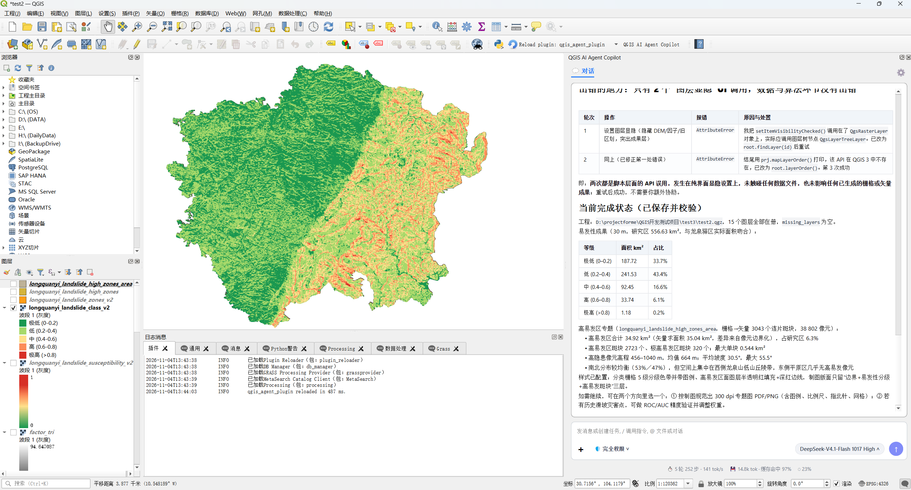</td>
<td>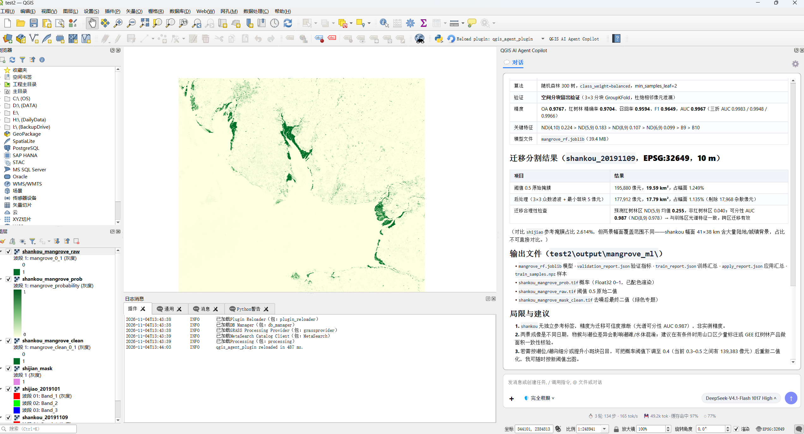</td>
</tr>
<tr>
<td align="center"><b>遥感影像掩膜叠加与水体 / 植被多光谱指数计算</b></td>
<td align="center"><b>OSM 交通路网获取、拓扑裁剪与分级专题制图</b></td>
</tr>
<tr>
<td>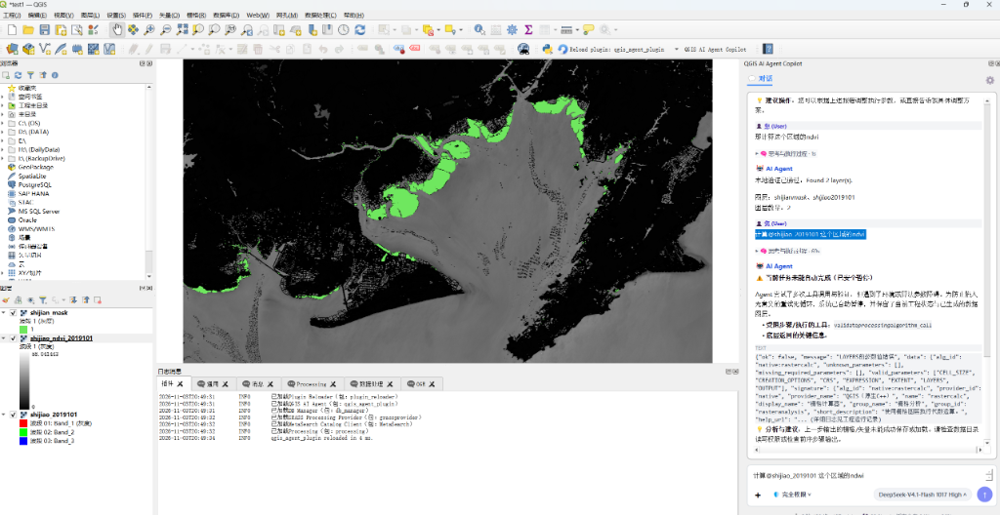</td>
<td></td>
</tr>
</table>

### 典型场景演示

#### 场景 1：遥感影像机器学习分类与跨区域迁移解译
> **「基于已标注红树林二值掩膜与多光谱影像，训练机器学习分类器，并在未知区域影像上完成推理分割」**
- **步骤 1（样本准备与特征提取）**：Agent 依据源影像与标签掩膜，提取多波段反射率及多种光谱指数（NDVI、NDWI、MNDWI、波段比值等），自动构建平衡样本集并做空间分组交叉验证；
- **步骤 2（模型训练与精度评估）**：自主训练随机森林等分类器，输出整体精度（OA 0.9767）、交并比（IoU 0.9594）与重要特征权重视图；
- **步骤 3（未知区域推理分割）**：加载目标未知区域遥感影像，批量生成概率分布栅格与分类图层，自动完成连通域滤波与面积统计报表，全过程自动沉淀验证报告。

#### 场景 2：基于 DEM 地貌与多光谱指数的滑坡易发性评价与危险区识别
> **「以四川成都市龙泉驿区为研究区，综合 DEM 地形起伏与 NDWI/NDVI 遥感指数，开展滑坡地质灾害易发性多级评价与高风险区自动矢量圈定」**
- **多源因子提取**：Agent 自动由 DEM 提取坡度、坡向、地形起伏度（TRI）及地表水文特征，协同计算水体指数（NDWI）与植被指数（NDVI）作为环境抑制与敏感因子；
- **综合易发性建模与五级划分**：加权综合计算连续易发性指数，按行业规范自动五级划分（极低 0-0.2、低 0.2-0.4、中 0.4-0.6、高 0.6-0.8、极高 >0.8），全区 558.63 km² 自动化空间划分；
- **高风险核心斑块矢量提取与报表统计**：自动提取高与极高易发区斑块（提炼出 2043 个斑块，核心风险区 34.92 km²，最大单块 0.544 km²），自动统计高程区间（456-1040 m，均值 684 m）与平均坡度 30.5°，保存工程并生成结构化地灾排查建议报表。

#### 场景 3：OSM 矢量数据一键获取与智能制图
> **「获取这个区域的交通矢量数据」**
- 读取工程 AOI 边界并换算 WGS84 范围，调用 OSM 下载道路 842 条、铁路 60 条（需 VPN）；
- 重投影至 UTM 平面投影并裁剪，按等级符号化渲染，统计路网总长 410.9 km 与路网密度 1.02 km/km² 并保存工程。

---

## 🏗️ 系统架构

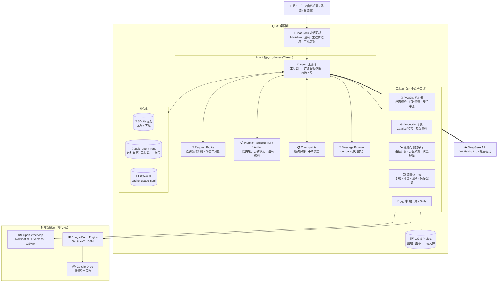

### 一次任务的执行流程

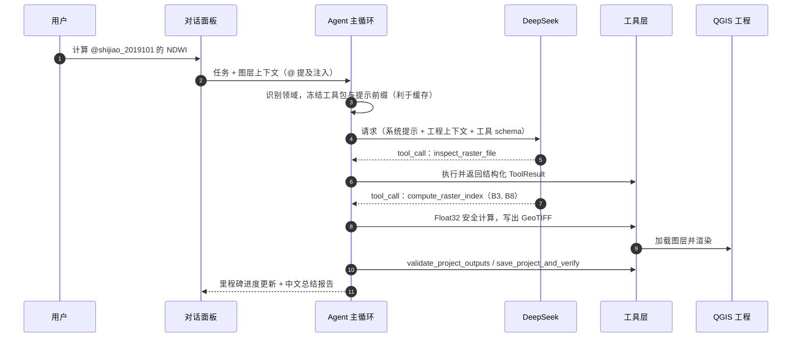

---

## 🚀 快速开始

### 1. 环境要求

| 项目 | 要求 |
|---|---|
| QGIS | 最低 `3.28`，推荐 `3.34 LTR` 或 `3.44` |
| Python 依赖 | `openai`（必需）、`earthengine-api`（GEE）、`requests` |
| 大模型 | [DeepSeek 开放平台](https://platform.deepseek.com) API Key |
| 网络 | **GEE / OSM 功能需开启 VPN**；可选 Google Drive Desktop 用于大文件同步 |

### 2. 安装插件

1. 从 [Releases](https://github.com/aboutqiguo/qgis-agent-plugin/releases/latest) 下载 `qgis_agent_plugin_v1.4.0.zip`；
2. QGIS 菜单 `插件` → `管理并安装插件` → `从 ZIP 安装`；
3. 选择 ZIP 文件安装并重启 QGIS；
4. 工具栏点击 **QGIS AI Agent Copilot** 打开右侧对话面板。

> [!TIP]
> 首次发送消息时，如检测到缺少 `openai` 依赖，插件会弹窗提示一键自动安装。

### 3. 手动安装依赖（可选）

**Windows**：在 QGIS 对应的 OSGeo4W Shell 中运行：

```cmd
python -m pip install openai earthengine-api requests scikit-learn
```

<details>
<summary><b>macOS：在 QGIS Python 控制台中安装</b></summary>

```python
import sys, runpy

original_argv = sys.argv[:]
sys.argv = ["pip", "install", "--user", "openai", "earthengine-api", "requests", "scikit-learn",
            "-i", "https://pypi.tuna.tsinghua.edu.cn/simple"]
try:
    runpy.run_module("pip", run_name="__main__")
except SystemExit as e:
    print("安装完成，请彻底重启 QGIS" if e.code == 0 else f"退出码：{e.code}")
finally:
    sys.argv = original_argv
```

</details>

### 4. 基础配置

点击对话面板右上角 ⚙️ 打开 **供应商配置**：

1. **DeepSeek**：填写 API Key（Base URL 默认 `https://api.deepseek.com`），点击「验证连接」；
2. **Google Earth Engine**（可选，需 VPN）：填写已启用 Earth Engine API 的 Google Cloud Project ID，点击「重新认证」完成浏览器授权；
3. **记忆与性格**（可选）：点击「构建 / 刷新本地 Catalog」索引本机 Processing 算法，可显著提升算法调用准确率。

---

## 🖥️ 界面介绍

### 对话面板

- **对话区**：支持 Markdown 表格、代码块、可折叠的「🧠 思考与执行过程」；
- **@ 提及**：输入 `@图层名` 自动注入该图层的 CRS、范围、数据源路径；
- **任务里程碑进度**：长任务以地铁线路图展示步骤状态（✔ 完成 / 🚆 运行 / ✖ 遇阻）；
- **权限模式**：底部切换「仅可查看 / 工作区内修改 / 完全权限」；
- **模型与思考强度**：可选 DeepSeek-V4 Flash / Pro 及 High / Max / Disabled 思考模式；
- **实时仪表**：轮次、步数、tok/s、累计 Token、缓存命中率、上下文占用。

<div align="center">
  
  <p><sub>任务里程碑进度条：中文节点、自动折行、圆润轨道与节点状态实时渲染</sub></p>
  <br/>
  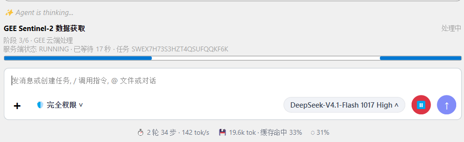
  <p><sub>GEE 云端遥感任务进度：阶段推进、服务端状态（RUNNING）与实时耗时智能追踪</sub></p>
</div>

### 设置窗口

<table>
<tr>
<td width="50%" align="center"><b>DeepSeek 配置</b><br/><sub>API 端点、密钥与连接验证，原生多模态视觉已启用</sub></td>
<td width="50%" align="center"><b>缓存监控</b><br/><sub>缓存命中率、费用估算与前缀稳定性诊断</sub></td>
</tr>
<tr>
<td>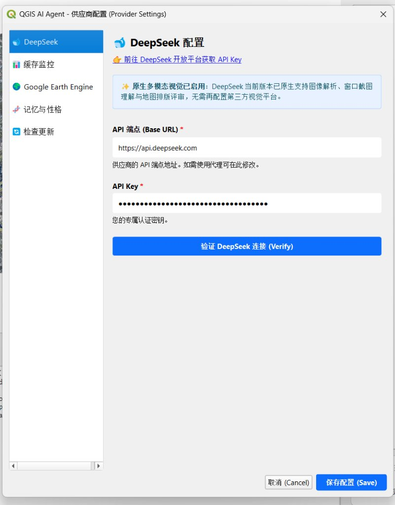</td>
<td>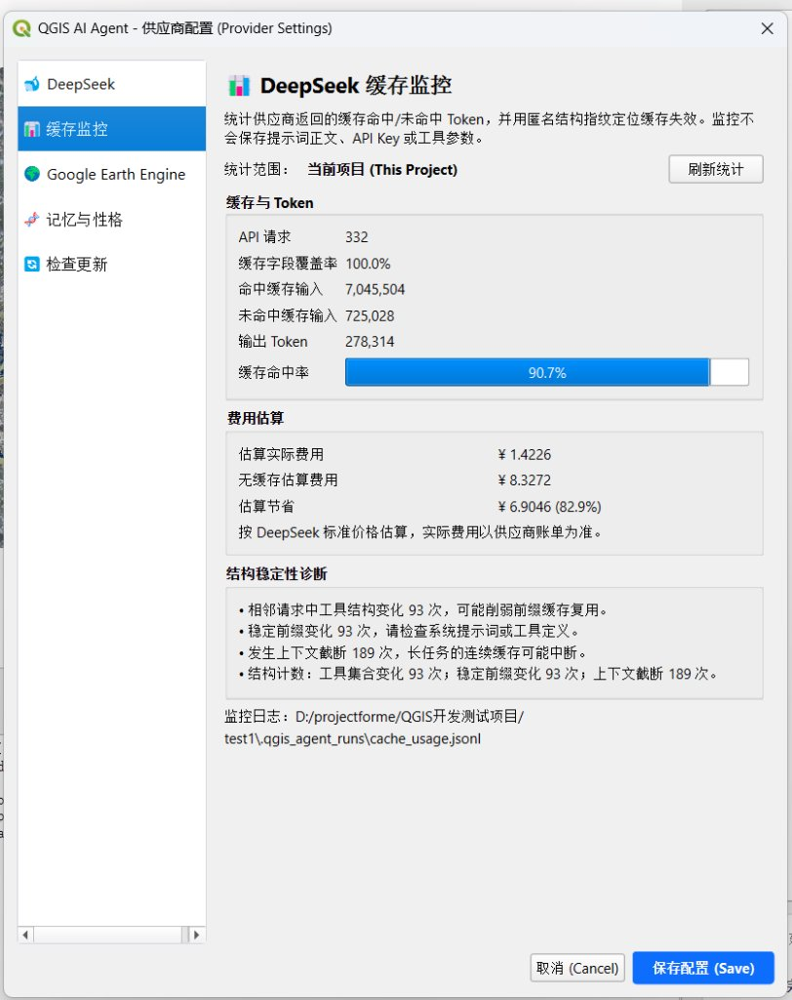</td>
</tr>
<tr>
<td align="center"><b>Google Earth Engine 配置</b><br/><sub>Project ID、认证与直连 / Drive 下载策略（需 VPN）</sub></td>
<td align="center"><b>记忆与性格</b><br/><sub>AI 性格、全局经验池、工程记忆与本地 Processing Catalog</sub></td>
</tr>
<tr>
<td>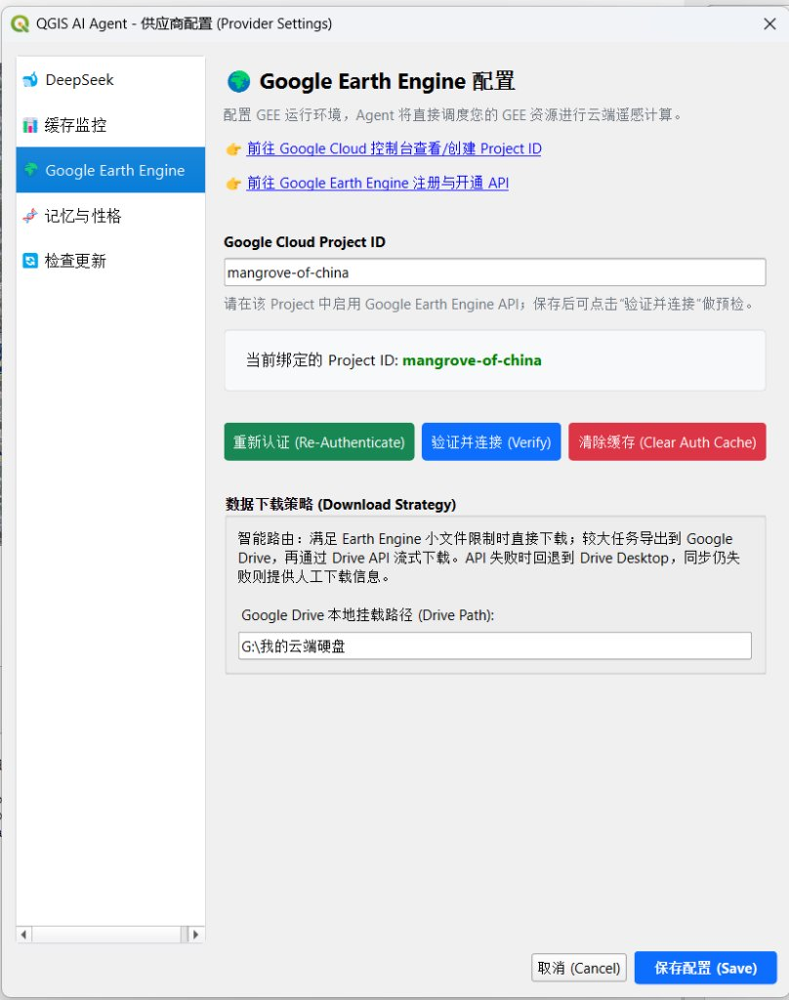</td>
<td>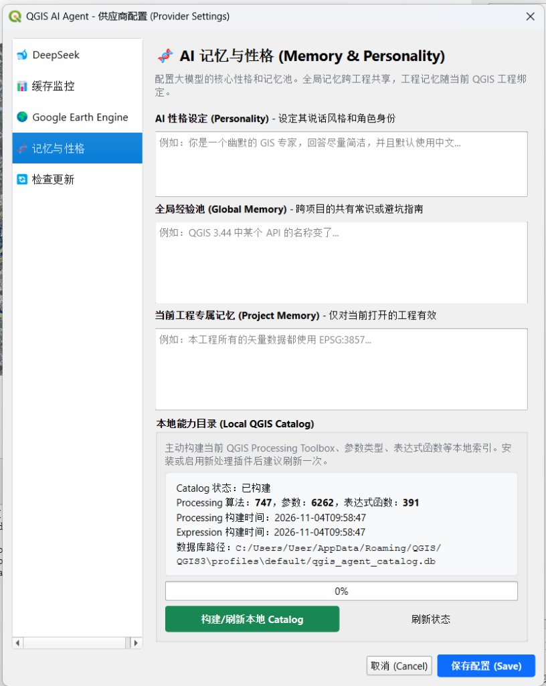</td>
</tr>
</table>

---

## 💡 使用示例

| 场景 | 提示词示例 | 网络 |
|---|---|---|
| 机器学习解译 | `基于 @shijian_mask 与 @shijiao_2019101 训练随机森林分类器，评估精度并在 @shankou_20191109 区域完成推理分割` | 本地 |
| 遥感指数 | `计算 @shijiao_2019101 这个区域的 NDWI，并用蓝色渐变渲染` | 本地 |
| 掩膜统计 | `基于 @shijian_mask 统计 @shijiao_2019101 各波段在掩膜内外的均值与标准差` | 本地 |
| 图层管理 | `删除除了 @shijiao_2019101 以外的图层，并加载 D:\data\mask.png` | 本地 |
| Processing | `将建筑物图层裁剪到研究区边界内，统计数量并保存工程` | 本地 |
| 水文分析 | `基于 DEM 做填洼、流向、汇流累积并提取河网` | 本地 |
| OSM 交通 | `获取这个区域的交通矢量数据，按道路等级分级渲染` | 🔐 VPN |
| OSM 边界 | `获取长沙市雨花区的行政边界、建筑物、POI 和水系` | 🔐 VPN |
| GEE 影像 | `基于研究区边界下载 2024 年夏季 Sentinel-2 SR，云量 <20%，B2/B3/B4/B8，10 m，median 合成` | 🔐 VPN |
| GEE DEM | `下载研究区 Copernicus DEM GLO-30，30 m，EPSG:4326，并加载到 QGIS` | 🔐 VPN |

**使用建议**

- 复杂任务建议先让 Agent 给出计划，确认后再执行；
- GEE 请求越明确越稳定（时间范围、波段、云量、分辨率、处理方式、输出名）；
- 叠加分析前确保输入数据 CRS、范围与像元大小一致；
- 任务中断后，直接回复「继续」即可从最近的执行节点恢复。

---

## 🌍 GEE 数据下载策略

```text
估算范围、像元数、波段数和网格尺寸
        │
        ├── 满足 Earth Engine 直连下载限制
        │       → getDownloadURL 直接下载
        │       → GeoTIFF 完整性与有效像元验证
        │
        └── 超限或直连失败
                → Export.image.toDrive（任务唯一前缀）
                → Drive API 流式下载 + 断点续传
                → 字节数与 GeoTIFF 校验
                → 失败时回退 Google Drive Desktop 同步
                → 仍失败时返回人工下载信息
```

> [!IMPORTANT]
> GEE 认证、导出与 Google Drive 下载全过程都需要访问 Google 服务，请确保 QGIS 进程能通过 VPN / 系统代理访问外网。

---

## ❓ 常见问题

<details>
<summary><b>OSM / GEE 下载一直超时或报网络错误？</b></summary>

请确认已开启 VPN，且 QGIS 进程可以使用该代理（部分 VPN 需开启「系统代理」或「TUN / 全局模式」）。可在 QGIS `设置 → 选项 → 网络` 中配置代理后重试。
</details>

<details>
<summary><b>Agent 提示「当前任务未能自动完成（已安全暂停）」？</b></summary>

为防止无意义的重试死循环，连续 4 次工具失败或达到单任务轮数上限时会自动暂停，并保留已生成的图层。可根据诊断卡片中的报错调整参数，或回复「继续」从断点恢复。
</details>

<details>
<summary><b>如何降低 Token 费用？</b></summary>

插件已冻结每个任务的系统提示与工具 schema 以提升 DeepSeek 前缀缓存命中率，可在「设置 → 缓存监控」查看命中率与费用估算。尽量在同一工程内连续提问效果更好。
</details>

<details>
<summary><b>提交 Issue 需要提供什么？</b></summary>

QGIS 版本、插件版本、操作系统、任务提示词，以及插件目录下 `utils/agent_run.log` 的相关片段或最小可复现数据。
</details>

---

## 📈 更新日志

### v1.4.0（2026-11）

- **原生多模态**：视觉能力统一迁移到 DeepSeek 原生通道，移除第三方视觉平台依赖；
- **遥感与机器学习**：新增 `compute_raster_index`、`compute_raster_zonal_stats`，Float32 安全计算避免 UInt16 下溢，新增遥感指数与机器学习推理分割 Skill；
- **任务里程碑进度**：全新地铁线路图式进度组件，节点全中文、自动换行、防重叠，仅从当前任务提取步骤；
- **断点与恢复**：执行节点 Checkpoint、中断恢复上下文、连续失败熔断与中文诊断卡片；
- **Processing 增强**：图层名 / ID 自动解析为数据源路径或图层对象，保留 `TEMPORARY_OUTPUT` 语义；
- **代码自愈**：新增 QGIS 3.44 渲染器 / GDAL 类型等高频 API 误用静态拦截，GDAL 临时数据集自动修复；
- **权限模式**：仅可查看 / 工作区内修改 / 完全权限三级模式，外部路径写入需授权；
- **记忆与缓存**：会话记忆原地更新避免「忘记上一轮」，新增缓存监控与费用估算面板；
- **UI 修复**：Markdown 渲染保留 `snake_case` 下划线；批量移除图层不再触发 C++ 对象已删除异常；
- 测试用例增至 153 项（含真实 QGIS C++ 无头冒烟测试与 GitHub Actions CI）。

<details>
<summary><b>历史版本</b></summary>

#### v1.3.3
- 结构化运行状态与保守完成判定；修复多工具消息协议；计划模式结构化步骤与 verifier；
- OSM 自适应分块、去重与安全写入；GEE 直连 / Drive 两级路由与断点续传；
- Processing 参数 fail-closed 校验；精简提示词与动态工具 schema。

#### v1.3.2
- QGIS 最低版本调整为 3.28；新增 DEM 下载工作流、栅格有效像元校验与 Processing Catalog。

#### v1.3.1-beta
- 强化工具模拟测试；优化 OSM / GEE / Processing / Skill 协同与项目记忆。

#### v1.1.0
- 基础架构、线程安全与 UI 兼容；初步接入 OSM、GEE、PyQGIS 与 Processing。

</details>

---

## 👨‍💻 开发与测试

```text
qgis_agent_plugin/
├── agent_plugin.py        插件入口
├── metadata.txt           QGIS 插件元数据
├── bridges/               GEE、OSM 外部数据桥接
├── core/                  Agent 主循环、规划/验证、工具注册、校验器、记忆、Catalog、断点
├── prompts/               系统提示词
├── skills/core/           GEE、OSM、GDAL 坑点、投影选择、制图、遥感指数等规则
├── tools/                 原子工具实现与 qgis_tools 子模块
├── ui/                    对话面板、设置窗口、Markdown 渲染、里程碑进度
└── utils/                 日志、依赖管理、更新检查
tests/                     单元测试与工具契约模拟测试
docs/                      图片与测试报告
```

```cmd
pytest tests -q            # 运行测试
python sync_dev.py         # 同步到本机 QGIS 插件目录（开发用）
python build.py            # 打包 qgis_agent_plugin_v1.4.0.zip
```

---

## 🗺️ 路线图

- [ ] 支持更多 LLM 供应商（GLM、Qwen、OpenAI 兼容接口）
- [ ] 出图排版（Layout）自动生成与视觉迭代评审
- [ ] 更多遥感数据源（Landsat、MODIS）与国内可直连数据源
- [ ] 英文界面与文档

---

## 📄 协议与致谢

本项目采用 **MIT License**。

开发过程中参考了 [GeoCode](https://github.com/chenyusheng2001/GeoCode)、Smart-QGIS、[qgis_mcp](https://github.com/jjsantos01/qgis_mcp)、MapAgent 等开源项目在 GIS Agent 方向的设计思路，感谢相关开源工作。

欢迎通过 [Issues](https://github.com/aboutqiguo/qgis-agent-plugin/issues) 提交问题与建议，如果这个项目对你有帮助，请点一个 ⭐ Star 支持！
