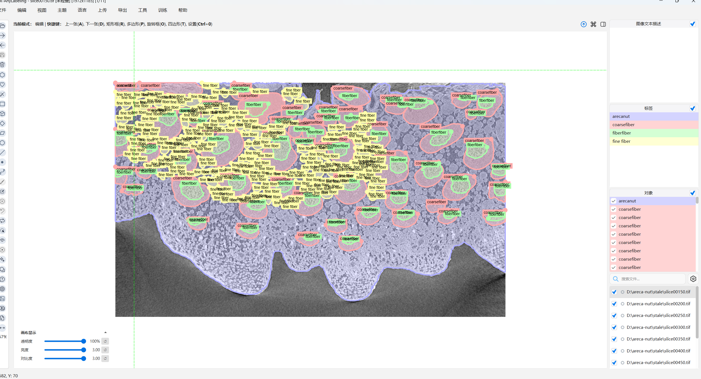
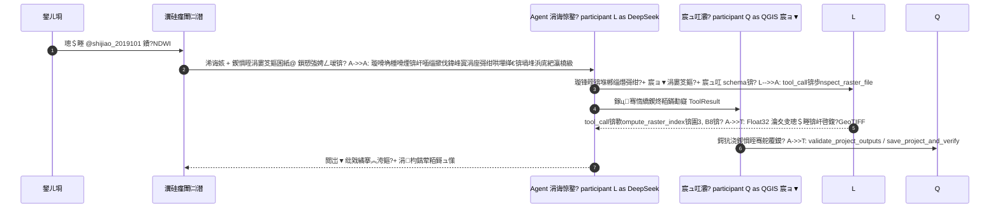

<div align="center">

# 馃審 QGIS AI Agent Copilot

**璁?QGIS 鍚噦鑷劧璇█ 鈥斺€?鍩轰簬 DeepSeek 鍘熺敓澶氭ā鎬佺殑 QGIS 鏅鸿兘 GIS 鍔╂墜**

*An AI Copilot for QGIS: natural-language geoprocessing, remote sensing, OSM / GEE data acquisition and cartography.*

[](https://github.com/aboutqiguo/qgis-agent-plugin/releases)
[](https://qgis.org)
[](https://www.python.org)
[](https://platform.deepseek.com)
[](#-寮€鍙戜笌娴嬭瘯)
[](#-鍗忚涓庤嚧璋?

[鍔熻兘鐗规€(#-鏍稿績鐗规€? 路 [鏁堟灉灞曠ず](#-搴旂敤鏁堟灉) 路 [绯荤粺鏋舵瀯](#-绯荤粺鏋舵瀯) 路 [蹇€熷紑濮媇(#-蹇€熷紑濮? 路 [UI 浠嬬粛](#-鐣岄潰浠嬬粛) 路 [浣跨敤绀轰緥](#-浣跨敤绀轰緥) 路 [鏇存柊鏃ュ織](#-鏇存柊鏃ュ織)


</div>

---

## 馃摉 椤圭洰绠€浠?
**QGIS AI Agent Copilot** 鏄竴涓繍琛屽湪 QGIS 鍐呴儴鐨勬櫤鑳戒綋锛圓gent锛夋彃浠躲€傚畠鎶?**澶ц瑷€妯″瀷锛圖eepSeek锛?*銆?*PyQGIS**銆?*QGIS Processing Toolbox锛?00+ 绠楁硶锛?*銆?*OpenStreetMap** 涓?**Google Earth Engine** 涓茶仈璧锋潵锛岀敤鎴峰彧闇€鍦ㄤ晶杈规爮鐢ㄤ腑鏂囨弿杩颁换鍔★紝Agent 灏变細鑷姩瀹屾垚锛?
> 鐞嗚В鎰忓浘 鈫?鎷嗚В璁″垝 鈫?閫夋嫨宸ュ叿 鈫?鎵ц澶勭悊 鈫?鏍￠獙缁撴灉 鈫?鍔犺浇娓叉煋 鈫?淇濆瓨宸ョ▼ 鈫?姹囨姤鎬荤粨

涓庛€岃澶фā鍨嬪啓涓€娈典唬鐮佸啀鎵嬪姩绮樿创銆嶄笉鍚岋紝鏈彃浠跺湪 QGIS 涓瀯寤轰簡瀹屾暣鐨?**宸ュ叿璋冪敤闂幆**锛?4 涓粨鏋勫寲鍘熷瓙宸ュ叿銆佸弬鏁伴潤鎬佹牎楠屻€丳yQGIS 浠ｇ爜瀹夊叏瀹℃煡涓庤嚜鍔ㄤ慨澶嶃€佹墽琛屾柇鐐广€佺粨鏋滄牳楠屼笌宸ョ▼绾ц蹇嗭紝灏藉彲鑳借姣忎竴姝ラ兘 **鍙墽琛屻€佸彲楠岃瘉銆佸彲鎭㈠**銆?
> [!WARNING]
> **缃戠粶璇存槑锛欸oogle Earth Engine锛圙EE锛変笌 OpenStreetMap锛圤SM / Overpass / Nominatim锛夌浉鍏冲姛鑳介渶瑕佸湪鍙闂浗闄呬簰鑱旂綉鐨勭綉缁滅幆澧冿紙VPN / 浠ｇ悊锛変笅浣跨敤銆?*
> 鍦ㄤ腑鍥藉ぇ闄嗙綉缁滅幆澧冧笅锛屾湭寮€鍚?VPN 鏃?GEE 璁よ瘉銆佸奖鍍忎笅杞姐€丟oogle Drive 鍚屾浠ュ強 OSM 杈圭晫 / 璺綉 / 瑕佺礌涓嬭浇鍧囧彲鑳借秴鏃舵垨澶辫触銆侱eepSeek 瀵硅瘽銆佹湰鍦版爡鏍?/ 鐭㈤噺鍒嗘瀽銆丳rocessing 绠楁硶璋冪敤涓嶅彈褰卞搷銆?
---

## 鉁?鏍稿績鐗规€?
| 妯″潡 | 鑳藉姏 |
|---|---|
| 馃 **鑷劧璇█ GIS 宸ヤ綔娴?* | 涓枃浠诲姟鑷姩鎷嗚В涓哄姝ラ璁″垝锛涙敮鎸佽鍒掑鎵广€佸垎姝ユ墽琛屻€佹柇鐐圭画璺戜笌澶辫触璇婃柇 |
| 馃憗锔?**DeepSeek 鍘熺敓澶氭ā鎬?* | 鏃犻渶绗笁鏂硅瑙夊钩鍙帮紝鐩存帴瑙ｆ瀽鎴浘銆佸湴鍥剧敾甯冧笌鍥剧墖闄勪欢锛屽苟瀵瑰嚭鍥炬帓鐗堣繘琛岃瑙夎瘎瀹?|
| 馃洶锔?**閬ユ劅鎸囨暟涓庡垎鍖虹粺璁?* | 鍐呯疆 `compute_raster_index` / `compute_raster_zonal_stats`锛岃嚜鍔ㄨ閬?UInt16 涓嬫孩锛屾敮鎸?NDVI / NDWI / MNDWI 绛夋寚鏁颁笌鎺╄啘鍒嗗尯缁熻 |
| 馃椇锔?**OSM 鐭㈤噺鏁版嵁鑾峰彇** | 琛屾斂杈圭晫銆侀亾璺€侀搧璺€佸缓绛戙€丳OI銆佹按绯汇€佸湡鍦板埄鐢紱鑷姩鍒嗗潡銆佸幓閲嶃€佽鍓€侀噸鎶曞奖涓庡垎绾х鍙峰寲 |
| 馃實 **GEE 浜戠閬ユ劅** | Sentinel-2銆丆opernicus DEM 涓嬭浇宸ヤ綔娴侊紱Earth Engine 鐩磋繛涓嬭浇 / Google Drive 鎵归噺瀵煎嚭涓ょ骇鏅鸿兘璺敱锛屾柇鐐圭画浼犱笌 GeoTIFF 瀹屾暣鎬ф牎楠?|
| 鈿欙笍 **Processing 鍏ㄩ噺璋冪敤** | 鏈湴鏋勫缓 747 涓畻娉?/ 6262 涓弬鏁?/ 391 涓〃杈惧紡鍑芥暟鐨?Catalog锛涜皟鐢ㄥ墠 fail-closed 鍙傛暟鏍￠獙锛岃嚜鍔ㄨВ鏋愬浘灞傚悕 鈫?鏁版嵁婧?|
| 馃洝锔?**瀹夊叏涓庢潈闄?* | 銆屼粎鍙煡鐪?/ 宸ヤ綔鍖哄唴淇敼 / 瀹屽叏鏉冮檺銆嶄笁绾фā寮忥紱鍒犻櫎鏂囦欢銆佹墽琛屼换鎰忎唬鐮併€佸畨瑁呬緷璧栫瓑楂樺嵄鎿嶄綔闇€浜哄伐瀹℃壒 |
| 馃敡 **浠ｇ爜鑷剤** | PyQGIS 闈欐€佹牎楠屽櫒鎷︽埅 QGIS 3.44 楂橀 API 骞昏锛堝 `bandName`銆乣setClassificationMode`銆丟DAL 绫诲瀷璇敤锛夛紝GDAL 涓存椂鏁版嵁闆嗚嚜鍔ㄤ慨澶?|
| 馃殗 **浠诲姟閲岀▼纰戣繘搴?* | 鍦伴搧绾胯矾鍥惧紡杩涘害鏉★紝涓枃鑺傜偣銆佽嚜鍔ㄦ崲琛岋紝瀹炴椂灞曠ず姣忎釜姝ラ鐨勫畬鎴?/ 杩愯 / 澶辫触鐘舵€?|
| 馃捑 **璁板繂涓庣紦瀛?* | 鍏ㄥ眬缁忛獙姹?+ 宸ョ▼涓撳睘璁板繂锛圫QLite锛夛紱DeepSeek 鍓嶇紑缂撳瓨鐩戞帶锛屽疄娴嬬紦瀛樺懡涓巼 90%+锛岃垂鐢ㄨ妭鐪佺害 80% |
| 馃З **鍙墿灞?* | 鏀寔鐢ㄦ埛鑷畾涔夊伐鍏凤紙User Tool Extensions锛変笌 Skill 瑙勫垯鏂囦欢锛孉gent 鍙矇娣€鍙鐢ㄧ殑澶勭悊鑳藉姏 |

---

## 馃幀 搴旂敤鏁堟灉

<table>
<tr>
<td width="50%" align="center"><b>OSM 浜ら€氳矾缃戣幏鍙栥€佽鍓笌鍒嗙骇娓叉煋</b></td>
<td width="50%" align="center"><b>DEM 濉醇銆佹祦鍚戜笌姘存枃鍒嗘瀽</b></td>
</tr>
<tr>
<td></td>
<td></td>
</tr>
<tr>
<td colspan="2" align="center"><b>閬ユ劅褰卞儚鎺╄啘鍙犲姞涓庢按浣?/ 妞嶈鎸囨暟璁＄畻</b></td>
</tr>
<tr>
<td colspan="2"></td>
</tr>
</table>

**绀轰緥锛氥€岃幏鍙栬繖涓尯鍩熺殑浜ら€氱煝閲忔暟鎹€?* 鈥斺€?Agent 鑷姩瀹屾垚锛?
1. 璇诲彇宸ョ▼涓殑 AOI 杈圭晫骞舵崲绠?WGS84 鑼冨洿锛?2. 浠?OSM 涓嬭浇閬撹矾 842 鏉°€侀搧璺?60 鏉★紙闇€ VPN锛夛紱
3. 閲嶆姇褰卞埌 UTM 48N 骞舵寜 AOI 绮剧‘瑁佸壀锛?4. 鎸?`highway` 绛夌骇閰嶇疆鍒嗙骇绗﹀彿锛堥珮閫?/ 鍥界渷閬?/ 鍘夸埂閬?/ 灞呬綇 / 姝ヨ锛夛紱
5. 缁熻璺綉鎬婚暱 410.9 km銆佽矾缃戝瘑搴?1.02 km/km虏锛屽苟淇濆瓨宸ョ▼銆?
---

## 馃彈锔?绯荤粺鏋舵瀯

```mermaid
flowchart TB
    U["馃懁 鐢ㄦ埛锛堜腑鏂囪嚜鐒惰瑷€ / 鎴浘 / @鍥惧眰锛?] --> UI

    subgraph QGIS["QGIS 妗岄潰绔?]
        UI["馃挰 Chat Dock 瀵硅瘽闈㈡澘<br/>Markdown 娓叉煋 路 閲岀▼纰戣繘搴?路 瀹℃壒寮圭獥"]
        UI --> H

        subgraph CORE["Agent 鏍稿績锛圚arnessThread锛?]
            H["馃攣 Agent 涓诲惊鐜?br/>宸ュ叿璋冪敤 路 杩炵画澶辫触鐔旀柇 路 杞暟涓婇檺"]
            RP["馃幆 Request Profile<br/>浠诲姟棰嗗煙璇嗗埆 路 鍔ㄦ€佸伐鍏峰寘"]
            PL["馃搵 Planner / StepRunner / Verifier<br/>璁″垝瀹℃壒 路 鍒嗘鎵ц 路 缁撴灉鏍搁獙"]
            CP["馃殗 Checkpoints<br/>鏂偣淇濆瓨 路 涓柇鎭㈠"]
            MP["馃Ь Message Protocol<br/>tool_calls 搴忓垪淇"]
            H <--> RP
            H <--> PL
            H <--> CP
            H <--> MP
        end

        subgraph TOOLS["宸ュ叿灞傦紙64 涓師瀛愬伐鍏凤級"]
            T1["馃搻 PyQGIS 鎵ц鍣?br/>闈欐€佹牎楠?路 浠ｇ爜淇 路 瀹夊叏瀹℃煡"]
            T2["鈿欙笍 Processing 璋冪敤<br/>Catalog 妫€绱?路 鍙傛暟鏍￠獙"]
            T3["馃洶锔?閬ユ劅鍒嗘瀽<br/>鎸囨暟璁＄畻 路 鍒嗗尯缁熻 路 鏍呮牸鏍￠獙"]
            T4["馃梻锔?鍥惧眰涓庡伐绋?br/>鍔犺浇 路 娓呯悊 路 娓叉煋 路 淇濆瓨楠岃瘉"]
            T5["馃З 鐢ㄦ埛鎵╁睍宸ュ叿 / Skills"]
        end

        H --> TOOLS
        TOOLS --> PRJ[("馃椇锔?QGIS Project<br/>鍥惧眰 路 鐢诲竷 路 宸ョ▼鏂囦欢")]

        subgraph STORE["鎸佷箙鍖?]
            M[("馃 SQLite 璁板繂<br/>鍏ㄥ眬 / 宸ョ▼")]
            A[("馃搧 .qgis_agent_runs<br/>杩愯鏃ュ織 路 宸ュ叿璋冪敤 路 鎶ュ憡")]
            C[("馃搳 缂撳瓨鐩戞帶<br/>cache_usage.jsonl")]
        end
        H <--> STORE
    end

    H <==> LLM["鈽侊笍 DeepSeek API<br/>V4 Flash / Pro 路 鍘熺敓瑙嗚"]

    subgraph EXT["澶栭儴鏁版嵁婧愶紙闇€ VPN锛?]
        OSM["馃椇锔?OpenStreetMap<br/>Nominatim 路 Overpass 路 OSMnx"]
        GEE["馃實 Google Earth Engine<br/>Sentinel-2 路 DEM"]
        GD["馃摝 Google Drive<br/>鎵归噺瀵煎嚭鍚屾"]
    end
    TOOLS --> OSM
    TOOLS --> GEE
    GEE --> GD
```

### 涓€娆′换鍔＄殑鎵ц娴佺▼



---

## 馃殌 蹇€熷紑濮?
### 1. 鐜瑕佹眰

| 椤圭洰 | 瑕佹眰 |
|---|---|
| QGIS | 鏈€浣?`3.28`锛屾帹鑽?`3.34 LTR` 鎴?`3.44` |
| Python 渚濊禆 | `openai`锛堝繀闇€锛夈€乣earthengine-api`锛圙EE锛夈€乣requests` |
| 澶фā鍨?| [DeepSeek 寮€鏀惧钩鍙癩(https://platform.deepseek.com) API Key |
| 缃戠粶 | **GEE / OSM 鍔熻兘闇€寮€鍚?VPN**锛涘彲閫?Google Drive Desktop 鐢ㄤ簬澶ф枃浠跺悓姝?|

### 2. 瀹夎鎻掍欢

1. 浠?[Releases](https://github.com/aboutqiguo/qgis-agent-plugin/releases/latest) 涓嬭浇 `qgis_agent_plugin_v1.4.0.zip`锛?2. QGIS 鑿滃崟 `鎻掍欢` 鈫?`绠＄悊骞跺畨瑁呮彃浠禶 鈫?`浠?ZIP 瀹夎`锛?3. 閫夋嫨 ZIP 鏂囦欢瀹夎骞堕噸鍚?QGIS锛?4. 宸ュ叿鏍忕偣鍑?**QGIS AI Agent Copilot** 鎵撳紑鍙充晶瀵硅瘽闈㈡澘銆?
> [!TIP]
> 棣栨鍙戦€佹秷鎭椂锛屽妫€娴嬪埌缂哄皯 `openai` 渚濊禆锛屾彃浠朵細寮圭獥鎻愮ず涓€閿嚜鍔ㄥ畨瑁呫€?
### 3. 鎵嬪姩瀹夎渚濊禆锛堝彲閫夛級

**Windows**锛氬湪 QGIS 瀵瑰簲鐨?OSGeo4W Shell 涓繍琛岋細

```cmd
python -m pip install openai earthengine-api requests
```

<details>
<summary><b>macOS锛氬湪 QGIS Python 鎺у埗鍙颁腑瀹夎</b></summary>

```python
import sys, runpy

original_argv = sys.argv[:]
sys.argv = ["pip", "install", "--user", "openai", "earthengine-api", "requests",
            "-i", "https://pypi.tuna.tsinghua.edu.cn/simple"]
try:
    runpy.run_module("pip", run_name="__main__")
except SystemExit as e:
    print("瀹夎瀹屾垚锛岃褰诲簳閲嶅惎 QGIS" if e.code == 0 else f"閫€鍑虹爜锛歿e.code}")
finally:
    sys.argv = original_argv
```

</details>

### 4. 鍩虹閰嶇疆

鐐瑰嚮瀵硅瘽闈㈡澘鍙充笂瑙?鈿欙笍 鎵撳紑 **渚涘簲鍟嗛厤缃?*锛?
1. **DeepSeek**锛氬～鍐?API Key锛圔ase URL 榛樿 `https://api.deepseek.com`锛夛紝鐐瑰嚮銆岄獙璇佽繛鎺ャ€嶏紱
2. **Google Earth Engine**锛堝彲閫夛紝闇€ VPN锛夛細濉啓宸插惎鐢?Earth Engine API 鐨?Google Cloud Project ID锛岀偣鍑汇€岄噸鏂拌璇併€嶅畬鎴愭祻瑙堝櫒鎺堟潈锛?3. **璁板繂涓庢€ф牸**锛堝彲閫夛級锛氱偣鍑汇€屾瀯寤?/ 鍒锋柊鏈湴 Catalog銆嶇储寮曟湰鏈?Processing 绠楁硶锛屽彲鏄捐憲鎻愬崌绠楁硶璋冪敤鍑嗙‘鐜囥€?
---

## 馃枼锔?鐣岄潰浠嬬粛

### 瀵硅瘽闈㈡澘

- **瀵硅瘽鍖?*锛氭敮鎸?Markdown 琛ㄦ牸銆佷唬鐮佸潡銆佸彲鎶樺彔鐨勩€岎煣?鎬濊€冧笌鎵ц杩囩▼銆嶏紱
- **@ 鎻愬強**锛氳緭鍏?`@鍥惧眰鍚峘 鑷姩娉ㄥ叆璇ュ浘灞傜殑 CRS銆佽寖鍥淬€佹暟鎹簮璺緞锛?- **浠诲姟閲岀▼纰戣繘搴?*锛氶暱浠诲姟浠ュ湴閾佺嚎璺浘灞曠ず姝ラ鐘舵€侊紙鉁?瀹屾垚 / 馃殕 杩愯 / 鉁?閬囬樆锛夛紱
- **鏉冮檺妯″紡**锛氬簳閮ㄥ垏鎹€屼粎鍙煡鐪?/ 宸ヤ綔鍖哄唴淇敼 / 瀹屽叏鏉冮檺銆嶏紱
- **妯″瀷涓庢€濊€冨己搴?*锛氬彲閫?DeepSeek-V4 Flash / Pro 鍙?High / Max / Disabled 鎬濊€冩ā寮忥紱
- **瀹炴椂浠〃**锛氳疆娆°€佹鏁般€乼ok/s銆佺疮璁?Token銆佺紦瀛樺懡涓巼銆佷笂涓嬫枃鍗犵敤銆?
<div align="center"></div>

### 璁剧疆绐楀彛

<table>
<tr>
<td width="50%" align="center"><b>DeepSeek 閰嶇疆</b><br/><sub>API 绔偣銆佸瘑閽ヤ笌杩炴帴楠岃瘉锛屽師鐢熷妯℃€佽瑙夊凡鍚敤</sub></td>
<td width="50%" align="center"><b>缂撳瓨鐩戞帶</b><br/><sub>缂撳瓨鍛戒腑鐜囥€佽垂鐢ㄤ及绠椾笌鍓嶇紑绋冲畾鎬ц瘖鏂?/sub></td>
</tr>
<tr>
<td></td>
<td></td>
</tr>
<tr>
<td align="center"><b>Google Earth Engine 閰嶇疆</b><br/><sub>Project ID銆佽璇佷笌鐩磋繛 / Drive 涓嬭浇绛栫暐锛堥渶 VPN锛?/sub></td>
<td align="center"><b>璁板繂涓庢€ф牸</b><br/><sub>AI 鎬ф牸銆佸叏灞€缁忛獙姹犮€佸伐绋嬭蹇嗕笌鏈湴 Processing Catalog</sub></td>
</tr>
<tr>
<td></td>
<td></td>
</tr>
</table>

---

## 馃挕 浣跨敤绀轰緥

| 鍦烘櫙 | 鎻愮ず璇嶇ず渚?| 缃戠粶 |
|---|---|---|
| 閬ユ劅鎸囨暟 | `璁＄畻 @shijiao_2019101 杩欎釜鍖哄煙鐨?NDWI锛屽苟鐢ㄨ摑鑹叉笎鍙樻覆鏌揱 | 鏈湴 |
| 鎺╄啘缁熻 | `鍩轰簬 @shijian_mask 缁熻 @shijiao_2019101 鍚勬尝娈靛湪鎺╄啘鍐呭鐨勫潎鍊间笌鏍囧噯宸甡 | 鏈湴 |
| 鍥惧眰绠＄悊 | `鍒犻櫎闄や簡 @shijiao_2019101 浠ュ鐨勫浘灞傦紝骞跺姞杞?D:\data\mask.png` | 鏈湴 |
| Processing | `灏嗗缓绛戠墿鍥惧眰瑁佸壀鍒扮爺绌跺尯杈圭晫鍐咃紝缁熻鏁伴噺骞朵繚瀛樺伐绋媊 | 鏈湴 |
| 姘存枃鍒嗘瀽 | `鍩轰簬 DEM 鍋氬～娲笺€佹祦鍚戙€佹眹娴佺疮绉苟鎻愬彇娌崇綉` | 鏈湴 |
| OSM 浜ら€?| `鑾峰彇杩欎釜鍖哄煙鐨勪氦閫氱煝閲忔暟鎹紝鎸夐亾璺瓑绾у垎绾ф覆鏌揱 | 馃攼 VPN |
| OSM 杈圭晫 | `鑾峰彇闀挎矙甯傞洦鑺卞尯鐨勮鏀胯竟鐣屻€佸缓绛戠墿銆丳OI 鍜屾按绯籤 | 馃攼 VPN |
| GEE 褰卞儚 | `鍩轰簬鐮旂┒鍖鸿竟鐣屼笅杞?2024 骞村瀛?Sentinel-2 SR锛屼簯閲?<20%锛孊2/B3/B4/B8锛?0 m锛宮edian 鍚堟垚` | 馃攼 VPN |
| GEE DEM | `涓嬭浇鐮旂┒鍖?Copernicus DEM GLO-30锛?0 m锛孍PSG:4326锛屽苟鍔犺浇鍒?QGIS` | 馃攼 VPN |

**浣跨敤寤鸿**

- 澶嶆潅浠诲姟寤鸿鍏堣 Agent 缁欏嚭璁″垝锛岀‘璁ゅ悗鍐嶆墽琛岋紱
- GEE 璇锋眰瓒婃槑纭秺绋冲畾锛堟椂闂磋寖鍥淬€佹尝娈点€佷簯閲忋€佸垎杈ㄧ巼銆佸鐞嗘柟寮忋€佽緭鍑哄悕锛夛紱
- 鍙犲姞鍒嗘瀽鍓嶇‘淇濊緭鍏ユ暟鎹?CRS銆佽寖鍥翠笌鍍忓厓澶у皬涓€鑷达紱
- 浠诲姟涓柇鍚庯紝鐩存帴鍥炲銆岀户缁€嶅嵆鍙粠鏈€杩戠殑鎵ц鑺傜偣鎭㈠銆?
---

## 馃實 GEE 鏁版嵁涓嬭浇绛栫暐

```text
浼扮畻鑼冨洿銆佸儚鍏冩暟銆佹尝娈垫暟鍜岀綉鏍煎昂瀵?        鈹?        鈹溾攢鈹€ 婊¤冻 Earth Engine 鐩磋繛涓嬭浇闄愬埗
        鈹?      鈫?getDownloadURL 鐩存帴涓嬭浇
        鈹?      鈫?GeoTIFF 瀹屾暣鎬т笌鏈夋晥鍍忓厓楠岃瘉
        鈹?        鈹斺攢鈹€ 瓒呴檺鎴栫洿杩炲け璐?                鈫?Export.image.toDrive锛堜换鍔″敮涓€鍓嶇紑锛?                鈫?Drive API 娴佸紡涓嬭浇 + 鏂偣缁紶
                鈫?瀛楄妭鏁颁笌 GeoTIFF 鏍￠獙
                鈫?澶辫触鏃跺洖閫€ Google Drive Desktop 鍚屾
                鈫?浠嶅け璐ユ椂杩斿洖浜哄伐涓嬭浇淇℃伅
```

> [!IMPORTANT]
> GEE 璁よ瘉銆佸鍑轰笌 Google Drive 涓嬭浇鍏ㄨ繃绋嬮兘闇€瑕佽闂?Google 鏈嶅姟锛岃纭繚 QGIS 杩涚▼鑳介€氳繃 VPN / 绯荤粺浠ｇ悊璁块棶澶栫綉銆?
---

## 鉂?甯歌闂

<details>
<summary><b>OSM / GEE 涓嬭浇涓€鐩磋秴鏃舵垨鎶ョ綉缁滈敊璇紵</b></summary>

璇风‘璁ゅ凡寮€鍚?VPN锛屼笖 QGIS 杩涚▼鍙互浣跨敤璇ヤ唬鐞嗭紙閮ㄥ垎 VPN 闇€寮€鍚€岀郴缁熶唬鐞嗐€嶆垨銆孴UN / 鍏ㄥ眬妯″紡銆嶏級銆傚彲鍦?QGIS `璁剧疆 鈫?閫夐」 鈫?缃戠粶` 涓厤缃唬鐞嗗悗閲嶈瘯銆?</details>

<details>
<summary><b>Agent 鎻愮ず銆屽綋鍓嶄换鍔℃湭鑳借嚜鍔ㄥ畬鎴愶紙宸插畨鍏ㄦ殏鍋滐級銆嶏紵</b></summary>

涓洪槻姝㈡棤鎰忎箟鐨勯噸璇曟寰幆锛岃繛缁?4 娆″伐鍏峰け璐ユ垨杈惧埌鍗曚换鍔¤疆鏁颁笂闄愭椂浼氳嚜鍔ㄦ殏鍋滐紝骞朵繚鐣欏凡鐢熸垚鐨勫浘灞傘€傚彲鏍规嵁璇婃柇鍗＄墖涓殑鎶ラ敊璋冩暣鍙傛暟锛屾垨鍥炲銆岀户缁€嶄粠鏂偣鎭㈠銆?</details>

<details>
<summary><b>濡備綍闄嶄綆 Token 璐圭敤锛?/b></summary>

鎻掍欢宸插喕缁撴瘡涓换鍔＄殑绯荤粺鎻愮ず涓庡伐鍏?schema 浠ユ彁鍗?DeepSeek 鍓嶇紑缂撳瓨鍛戒腑鐜囷紝鍙湪銆岃缃?鈫?缂撳瓨鐩戞帶銆嶆煡鐪嬪懡涓巼涓庤垂鐢ㄤ及绠椼€傚敖閲忓湪鍚屼竴宸ョ▼鍐呰繛缁彁闂晥鏋滄洿濂姐€?</details>

<details>
<summary><b>鎻愪氦 Issue 闇€瑕佹彁渚涗粈涔堬紵</b></summary>

QGIS 鐗堟湰銆佹彃浠剁増鏈€佹搷浣滅郴缁熴€佷换鍔℃彁绀鸿瘝锛屼互鍙婃彃浠剁洰褰曚笅 `utils/agent_run.log` 鐨勭浉鍏崇墖娈垫垨鏈€灏忓彲澶嶇幇鏁版嵁銆?</details>

---

## 馃搱 鏇存柊鏃ュ織

### v1.4.0锛?026-11锛?
- **鍘熺敓澶氭ā鎬?*锛氳瑙夎兘鍔涚粺涓€杩佺Щ鍒?DeepSeek 鍘熺敓閫氶亾锛岀Щ闄ょ涓夋柟瑙嗚骞冲彴渚濊禆锛?- **閬ユ劅宸ュ叿**锛氭柊澧?`compute_raster_index`銆乣compute_raster_zonal_stats`锛孎loat32 瀹夊叏璁＄畻閬垮厤 UInt16 涓嬫孩锛屾柊澧為仴鎰熸寚鏁?Skill锛?- **浠诲姟閲岀▼纰戣繘搴?*锛氬湴閾佺嚎璺浘寮忚繘搴︾粍浠讹紝鑺傜偣鍏ㄤ腑鏂囥€佽嚜鍔ㄦ崲琛屻€侀槻閲嶅彔锛屼粎浠庡綋鍓嶄换鍔℃彁鍙栨楠わ紱
- **鏂偣涓庢仮澶?*锛氭墽琛岃妭鐐?Checkpoint銆佷腑鏂仮澶嶄笂涓嬫枃銆佽繛缁け璐ョ啍鏂笌涓枃璇婃柇鍗＄墖锛?- **Processing 澧炲己**锛氬浘灞傚悕 / ID 鑷姩瑙ｆ瀽涓烘暟鎹簮璺緞鎴栧浘灞傚璞★紝淇濈暀 `TEMPORARY_OUTPUT` 璇箟锛?- **浠ｇ爜鑷剤**锛氭柊澧?QGIS 3.44 娓叉煋鍣?/ GDAL 绫诲瀷绛夐珮棰?API 璇敤闈欐€佹嫤鎴紝GDAL 涓存椂鏁版嵁闆嗚嚜鍔ㄤ慨澶嶏紱
- **鏉冮檺妯″紡**锛氫粎鍙煡鐪?/ 宸ヤ綔鍖哄唴淇敼 / 瀹屽叏鏉冮檺涓夌骇妯″紡锛屽閮ㄨ矾寰勫啓鍏ラ渶鎺堟潈锛?- **璁板繂涓庣紦瀛?*锛氫細璇濊蹇嗗師鍦版洿鏂伴伩鍏嶃€屽繕璁颁笂涓€杞€嶏紝鏂板缂撳瓨鐩戞帶涓庤垂鐢ㄤ及绠楅潰鏉匡紱
- **UI 淇**锛歁arkdown 娓叉煋淇濈暀 `snake_case` 涓嬪垝绾匡紱鎵归噺绉婚櫎鍥惧眰涓嶅啀瑙﹀彂 C++ 瀵硅薄宸插垹闄ゅ紓甯革紱
- 娴嬭瘯鐢ㄤ緥澧炶嚦 140 椤广€?
<details>
<summary><b>鍘嗗彶鐗堟湰</b></summary>

#### v1.3.3
- 缁撴瀯鍖栬繍琛岀姸鎬佷笌淇濆畧瀹屾垚鍒ゅ畾锛涗慨澶嶅宸ュ叿娑堟伅鍗忚锛涜鍒掓ā寮忕粨鏋勫寲姝ラ涓?verifier锛?- OSM 鑷€傚簲鍒嗗潡銆佸幓閲嶄笌瀹夊叏鍐欏叆锛汫EE 鐩磋繛 / Drive 涓ょ骇璺敱涓庢柇鐐圭画浼狅紱
- Processing 鍙傛暟 fail-closed 鏍￠獙锛涚簿绠€鎻愮ず璇嶄笌鍔ㄦ€佸伐鍏?schema銆?
#### v1.3.2
- QGIS 鏈€浣庣増鏈皟鏁翠负 3.28锛涙柊澧?DEM 涓嬭浇宸ヤ綔娴併€佹爡鏍兼湁鏁堝儚鍏冩牎楠屼笌 Processing Catalog銆?
#### v1.3.1-beta
- 寮哄寲宸ュ叿妯℃嫙娴嬭瘯锛涗紭鍖?OSM / GEE / Processing / Skill 鍗忓悓涓庨」鐩蹇嗐€?
#### v1.1.0
- 鍩虹鏋舵瀯銆佺嚎绋嬪畨鍏ㄤ笌 UI 鍏煎锛涘垵姝ユ帴鍏?OSM銆丟EE銆丳yQGIS 涓?Processing銆?
</details>

---

## 馃懆鈥嶐煉?寮€鍙戜笌娴嬭瘯

```text
qgis_agent_plugin/
鈹溾攢鈹€ agent_plugin.py        鎻掍欢鍏ュ彛
鈹溾攢鈹€ metadata.txt           QGIS 鎻掍欢鍏冩暟鎹?鈹溾攢鈹€ bridges/               GEE銆丱SM 澶栭儴鏁版嵁妗ユ帴
鈹溾攢鈹€ core/                  Agent 涓诲惊鐜€佽鍒?楠岃瘉銆佸伐鍏锋敞鍐屻€佹牎楠屽櫒銆佽蹇嗐€丆atalog銆佹柇鐐?鈹溾攢鈹€ prompts/               绯荤粺鎻愮ず璇?鈹溾攢鈹€ skills/core/           GEE銆丱SM銆丟DAL 鍧戠偣銆佹姇褰遍€夋嫨銆佸埗鍥俱€侀仴鎰熸寚鏁扮瓑瑙勫垯
鈹溾攢鈹€ tools/                 鍘熷瓙宸ュ叿瀹炵幇涓?qgis_tools 瀛愭ā鍧?鈹溾攢鈹€ ui/                    瀵硅瘽闈㈡澘銆佽缃獥鍙ｃ€丮arkdown 娓叉煋銆侀噷绋嬬杩涘害
鈹斺攢鈹€ utils/                 鏃ュ織銆佷緷璧栫鐞嗐€佹洿鏂版鏌?tests/                     鍗曞厓娴嬭瘯涓庡伐鍏峰绾︽ā鎷熸祴璇?docs/                      鍥剧墖涓庢祴璇曟姤鍛?```

```cmd
pytest tests -q            # 杩愯娴嬭瘯
python sync_dev.py         # 鍚屾鍒版湰鏈?QGIS 鎻掍欢鐩綍锛堝紑鍙戠敤锛?python build.py            # 鎵撳寘 qgis_agent_plugin_v1.4.0.zip
```

---

## 馃椇锔?璺嚎鍥?
- [ ] 鏀寔鏇村 LLM 渚涘簲鍟嗭紙GLM銆丵wen銆丱penAI 鍏煎鎺ュ彛锛?- [ ] 鍑哄浘鎺掔増锛圠ayout锛夎嚜鍔ㄧ敓鎴愪笌瑙嗚杩唬璇勫
- [ ] 鏇村閬ユ劅鏁版嵁婧愶紙Landsat銆丮ODIS锛変笌鍥藉唴鍙洿杩炴暟鎹簮
- [ ] 鑻辨枃鐣岄潰涓庢枃妗?
---

## 馃搫 鍗忚涓庤嚧璋?
鏈」鐩噰鐢?**MIT License**銆?
寮€鍙戣繃绋嬩腑鍙傝€冧簡 [GeoCode](https://github.com/chenyusheng2001/GeoCode)銆丼mart-QGIS銆乕qgis_mcp](https://github.com/jjsantos01/qgis_mcp)銆丮apAgent 绛夊紑婧愰」鐩湪 GIS Agent 鏂瑰悜鐨勮璁℃€濊矾锛屾劅璋㈢浉鍏冲紑婧愬伐浣溿€?
娆㈣繋閫氳繃 [Issues](https://github.com/aboutqiguo/qgis-agent-plugin/issues) 鎻愪氦闂涓庡缓璁紝濡傛灉杩欎釜椤圭洰瀵逛綘鏈夊府鍔╋紝璇风偣涓€涓?猸?Star 鏀寔锛?
