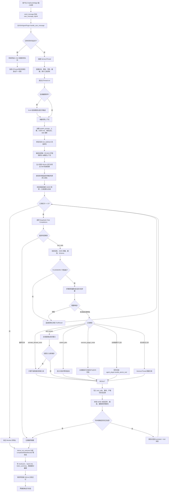
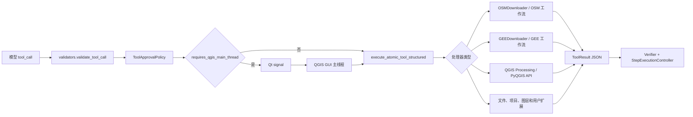
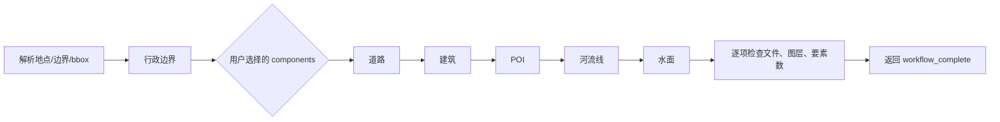
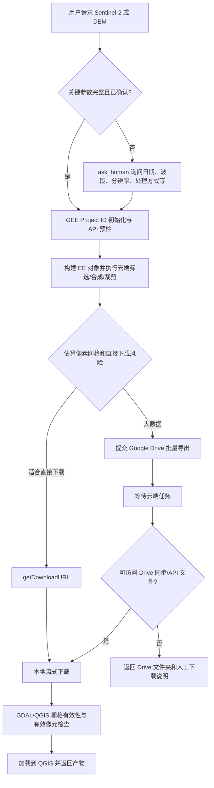

# QGIS AI Agent v1.3.3 全量审计、工作流与代码组织说明

> 审计日期：2026-08-26  
> 审计对象：`qgis_agent_plugin/`、`tests/`、构建与发布文件  
> 当前版本：`1.3.3`  
> QGIS 兼容范围：`3.28` 至 `3.99`

## 1. 审计结论

当前 Agent 已经不是单纯的“模型生成 PyQGIS 代码并执行”插件，而是形成了由以下层级组成的受控执行系统：

1. QGIS 插件生命周期与主线程桥接；
2. 对话界面、设置、计划审批和运行进度；
3. 任务级提示词、上下文和工具包默认冻结，并支持受控的只增不减领域扩展；
4. DeepSeek 决策循环与 GLM 视觉辅助；
5. 62 个注册工具及其风险、线程、权限和产物元数据；
6. OSM、GEE、QGIS Processing、文件、图层、制图等领域工具；
7. 计划、步骤门控、本地验证、结果状态和运行产物；
8. 项目级 SQLite 记忆、QGIS 能力目录和缓存命中监控；
9. 经用户批准的 PyQGIS 代码兜底与用户工具扩展机制。

静态编译和 97 项自动测试全部通过。当前未发现会令所有任务立即不可用的 P0 缺陷。审计最初识别出的 4 项 P1 风险已在同版本 `1.3.3` 中完成修复；后续真实测试发现的“模糊请求澄清后缺少领域工具”问题也已通过关键词补全、`activate_domain_tools` 和最多两次单调扩展修复。

版本号保持 `1.3.3`，修复内容通过新增自动测试和完整回归验证。

## 2. 审计范围与规模

| 项目 | 结果 |
|---|---:|
| 插件正式文件 | 56 |
| Python 文件 | 49 |
| Markdown 提示词/技能文件 | 6 |
| 源目录额外 IDE 文件 | 5 个 `.idea` 文件 |
| 自动测试模块 | 15 |
| 自动测试用例 | 97 |
| 注册工具 | 62 |
| 低/中/高风险工具 | 37 / 15 / 10 |
| 需要 QGIS 主线程的工具 | 42 |
| 需要网络的工具 | 11 |
| 需要认证的工具 | 5 |
| 会修改 QGIS 项目的工具 | 22 |
| 只读工具 | 31 |
| 可进入批处理的工具 | 11 |

不属于插件运行时的目录：

- `参考项目/`：外部项目和研究样本，不参与插件加载、构建和测试；
- `日志文件/`：历史日志、抓取结果和分析报告；
- `backups/`：版本与安装目录备份；
- 根目录的实验 Markdown：人工测试方案和历史稳定性报告。

## 3. 用户请求后的完整调用流程

### 3.1 主调用工作流



### 3.2 工具实际执行路径



### 3.3 OSM 高层工作流

`run_osm_acquisition_workflow` 接收可选的 `components`，不是强制下载全部类型。默认或用户指定后按以下顺序串行执行：



- 只需要一个或几个类型时，只执行所选组件；
- 其他 OSM 标签可走 `download_osm_features`，通过 `preset`、`tags`、`geometry_type` 获取；
- 大范围 bbox 由 `split_bbox` 分块，网络下载按顺序执行，避免并发压垮 Overpass；
- 每个阶段通过统一进度协议报告状态，并支持用户取消。

### 3.4 GEE 高层工作流



进度分为参数/认证、云端处理、导出等待、本地下载、校验加载等阶段。Earth Engine 直接下载限制与 Google Drive API 下载不是同一个限制，当前路由已分开处理。

## 4. 当前目录组织

```text
QGIS开发3.44/
├─ qgis_agent_plugin/          # 可安装的 QGIS 插件源代码
│  ├─ agent_plugin.py          # QGIS 生命周期与主线程总入口
│  ├─ bridges/                 # OSM/GEE 外部平台适配层
│  ├─ core/                    # Agent 编排、状态、验证、安全和存储
│  ├─ prompts/                 # 全局系统提示词
│  ├─ skills/                  # 按需加载的 GIS 领域知识
│  ├─ tools/                   # 工具 Schema、分发和 QGIS 工具实现
│  ├─ ui/                      # 对话、设置和交互界面
│  └─ utils/                   # 日志和自动更新
├─ tests/                      # 不依赖完整 QGIS GUI 的自动测试
├─ build.py                    # 生成 QGIS 可安装 ZIP
├─ plugins.xml                 # QGIS 插件仓库索引
├─ README.md                   # GitHub 使用说明
├─ qgis_agent_plugin_v1.3.3.zip
├─ backups/                    # 本地备份，不参与构建
├─ 日志文件/                  # 历史测试材料，不参与构建
└─ 参考项目/                  # 研究参考样本，不参与构建
```

依赖方向原则：

```text
ui -> agent_plugin -> core orchestration -> tool registry/validators
                                  |      -> tools dispatcher -> qgis_tools
                                  |      -> bridges -> OSM/GEE/network
                                  -> artifacts/memory/cache metrics
```

`bridges` 和 `qgis_tools` 不应反向依赖 UI；需要主线程的动作通过 Qt signal 返回 `agent_plugin.py` 执行。

## 5. 插件逐目录、逐文件说明

### 5.1 插件根目录

| 文件 | 内容与功能 |
|---|---|
| `__init__.py` | QGIS `classFactory(iface)` 入口；补充用户 site-packages 后创建 `QGISAIAgentPlugin`。 |
| `agent_plugin.py` | 插件生命周期、DockWidget 创建、项目事件监听、HarnessThread 管理、主线程工具/截图/代码执行、进度转发、重复图层清理和项目记忆切换。 |
| `metadata.txt` | 插件名称、版本、QGIS 最低/最高版本、说明、仓库和依赖元数据。 |
| `.idea/*` | IDE 工程配置，不属于运行时；构建脚本已排除，但仍残留在插件源目录。 |

### 5.2 `bridges/`：外部数据平台适配

| 文件 | 内容与功能 |
|---|---|
| `bridges/__init__.py` | 包标记。 |
| `bridges/osm_bridge.py` | Nominatim 边界查询、Overpass QL 规范化、bbox 解析/面积/分块、错误分类、调试文件、OSM 下载、子图层加载、道路网络清洗。 |
| `bridges/gee_bridge.py` | GEE Project ID 认证和预检；直接下载、Drive 导出等待、Drive 同步/复制任务；分阶段进度；人工下载兜底；地图瓦片辅助。`AgentMap` 当前无调用引用，属于遗留实现。 |

### 5.3 `core/`：Agent 核心

| 文件 | 内容与功能 |
|---|---|
| `core/__init__.py` | 包标记。 |
| `core/harness_thread.py` | Agent 核心循环：提示词与上下文组装、模型调用、工具包冻结、协议修复、模式门控、审批、工具分发、重试、自修复、验证、产物与结束状态。当前约 2247 行，是最大编排热点之一。 |
| `core/tool_registry.py` | 62 个工具的统一注册表；生成 OpenAI Tool Schema；记录风险、主线程、网络、认证、路径、读写、副作用和批处理能力；执行注册健康检查。 |
| `core/validators.py` | 工具参数、JSON Schema、图层、Processing、输出路径和 PyQGIS 代码的调用前校验；处理外部写入路径授权与重定向。 |
| `core/approval_policy.py` | 本地审批策略；未知工具、高风险工具、任意代码、用户工具、覆盖现有文件等操作要求用户批准。 |
| `core/path_access.py` | 当前任务内的外部写入目录临时授权；任务结束后撤销。 |
| `core/tool_result.py` | `ToolResult` 统一成功/失败结构、错误类型识别、旧文本结果兼容和 JSON 标准化。 |
| `core/message_protocol.py` | 修复 OpenAI tool_calls 与 tool 消息不配对、缺失、重复和孤立问题，防止 `insufficient tool messages` 类 400 错误。 |
| `core/request_profile.py` | 根据用户原始请求识别 OSM/GEE/Processing/制图等领域；选择确定性工具包；提供只增不减的领域扩展；对 Schema 和 JSON 排序以提高缓存命中。 |
| `core/cache_metrics.py` | 从供应商响应提取缓存命中/未命中 Token，生成结构哈希，估算费用并维护 30 天遥测日志；不保存提示词正文、API Key 或工具参数。 |
| `core/planner.py` | 将 Markdown 或结构化计划转换为 `TaskPlan`，推断步骤工具和预期文件/图层/产物。 |
| `core/task_state.py` | `TaskPlan`、`TaskStep`、`StepVerification` 数据模型。 |
| `core/step_runner.py` | 控制每个工具调用是否符合当前活动步骤，记录开始、完成和验证状态。 |
| `core/verifier.py` | 本地检查工具结果、预期文件、图层、栅格、截图、样式和产物完整性；计算质量分、严重度及重试建议。 |
| `core/run_state.py` | 根据计划、工具成功/失败和覆盖状态生成 `completed`、`failed`、`blocked`、`cancelled` 等最终状态。 |
| `core/local_continuation.py` | 判断高层 OSM/GEE/简单查询是否可由本地结果直接完成，避免一次无价值的模型过渡请求。 |
| `core/artifacts.py` | 在项目 `.qgis_agent_runs/` 下记录任务、计划、步骤、工具调用、审批、注册表、Token、数据源、结果、截图、图层报告和总报告。 |
| `core/sqlite_memory.py` | 项目级 `qgis_agent_memory.db`；保存/加载对话并支持关键词检索。 |
| `core/processing_catalog.py` | 建立 `qgis_agent_catalog.db`；索引 Processing 算法、参数、输出和 QGIS 表达式函数，支持全文检索、描述和调用校验。 |
| `core/result_inspector.py` | 检查 QGIS 图层和 Processing 输出，生成任务结束时的图层报告。 |
| `core/project_persistence.py` | 保存 `.qgz/.qgs` 后从工程 XML 和 QGIS 状态验证项目是否真正持久化。 |
| `core/raster_validation.py` | 使用 GDAL，必要时退回 QGIS Provider，检查尺寸、波段、范围、NoData 和有效像元。 |
| `core/progress.py` | 统一数据获取进度事件、阶段百分比、完成/失败/取消状态。 |
| `core/data_sources.py` | OSM、GEE 等数据源目录、搜索评分、数据获取方案和 Markdown 说明。 |
| `core/gee_routing.py` | 根据像素网格和估算大小决定 GEE 直接下载还是批量导出。 |
| `core/code_repair.py` | 对常见 QGIS/GDAL/Nominatim 代码错误做静态检测和有限的确定性修复。 |
| `core/code_execution_guard.py` | 任意主线程代码的静态阻断与运行时限；拒绝同步网络、Processing、等待、无界循环、动态执行和过大固定循环。 |
| `core/user_tool_extensions.py` | 在 QGIS 用户配置目录保存候选工具；校验 AST 和 `run(iface, arguments)` 契约；测试成功后经二次审批注册到未来任务。 |
| `core/mode_state.py` | 识别“继续”等续跑消息、已批准计划恢复以及 GEE 配置完成后的恢复消息。 |

### 5.4 `prompts/`：主提示词

| 文件 | 内容与功能 |
|---|---|
| `prompts/system_prompt.md` | Agent 总行为规则：优先注册工具、代码仅作兜底、计划/工作模式、参数确认、OSM/GEE 规范、验证、能力缺口扩展、记忆边界和 Token 控制。 |

系统提示词不是唯一指令来源。运行时还会追加：设置中的人格、可选 `USER.md`、项目 `MEMORY.md` 摘要和索引、Skill 清单、QGIS 环境快照、@图层上下文及自动 RAG 结果。

### 5.5 `skills/`：领域知识

| 文件 | 内容与功能 |
|---|---|
| `skills/core/osm_nominatim.md` | Nominatim/Overpass 使用方式、查询和常见错误。 |
| `skills/core/gee_execution.md` | GEE 认证、参数确认、Sentinel-2/DEM 工作流、直接下载与 Drive 导出边界及恢复流程。 |
| `skills/core/qgis_gdal_quirks.md` | QGIS/GDAL 驱动、图层加载、GeoPackage、颜色和重复图层等已知坑。 |
| `skills/core/qgis_layout_design.md` | QGIS 制图布局、地图项、图例、比例尺和导出规则。 |
| `skills/core/qgis_projection_selection.md` | 分析与制图时的 CRS/投影选择原则。 |

动态 Skill 可由 `save_or_update_dynamic_skill` 写入 `skills/dynamic/`，但该位置位于插件安装目录，存在更新覆盖和只读安装环境风险。

### 5.6 `tools/`：工具定义和分发

| 文件 | 内容与功能 |
|---|---|
| `tools/__init__.py` | 包标记。 |
| `tools/tools.py` | 内置工具 Schema、通用分发器和大量处理器实现；包含 OSM/GEE、文件、项目、Processing、图层、技能、用户工具和批处理。当前约 3702 行、约 179 KB，是最大维护热点。 |

### 5.7 `tools/qgis_tools/`：可复用 QGIS 操作

| 文件 | 内容与功能 |
|---|---|
| `qgis_tools/__init__.py` | 延迟导出 QGIS helper，避免导入一个工具时初始化全部 GUI/Processing 模块。 |
| `qgis_tools/io_tools.py` | 查找、复用、加载、去重和保存矢量/栅格图层。末尾存在一个未导出的旧 `open_georeferencer` 重复实现。 |
| `qgis_tools/geoprocessing_tools.py` | CRS 防护、缓冲、矢量裁剪、栅格裁剪和输出有效性检查。 |
| `qgis_tools/workflow_tools.py` | 连续 OSM 数据获取和批量矢量按边界裁剪。 |
| `qgis_tools/external_data.py` | 只读加载工程外数据，或连同 Shapefile sidecar 流式复制到项目目录后加载。 |
| `qgis_tools/gui_tools.py` | 打开地理配准器、数据源管理器、布局管理器、样式管理器、捕捉设置和属性表。 |
| `qgis_tools/mapping_tools.py` | 根据当前图层快速渲染地图图片。当前仅通过 helper 导出，未注册为独立模型工具。 |

### 5.8 `ui/`：界面

| 文件 | 内容与功能 |
|---|---|
| `ui/__init__.py` | 包标记。 |
| `ui/chat_dockwidget.py` | 对话 Dock、长问题自动换行弹窗、模型/模式菜单、输入框、截图附件、任务计划、进度条、文件监听和运行产物展示。 |
| `ui/settings_dialog.py` | DeepSeek、GLM、GEE、记忆人格、缓存监控、QGIS 能力目录、更新检查和认证验证页面；使用 QGIS 主题调色板适配明暗模式。 |

### 5.9 `utils/`：基础服务

| 文件 | 内容与功能 |
|---|---|
| `utils/__init__.py` | 包标记。 |
| `utils/logger.py` | Python 日志和 QGIS Message Log 双写；当前文件日志位于插件安装目录 `utils/agent_run.log`，5 MB 轮转、保留 3 个备份。 |
| `utils/update_checker.py` | 从 GitHub 读取远端版本；异步检查；下载 Release ZIP，校验压缩路径和根目录后覆盖安装。 |

## 6. 根目录构建、发布与测试文件

| 文件/目录 | 内容与功能 |
|---|---|
| `build.py` | 从 `metadata.txt` 读取版本并生成 ZIP；排除 `.idea`、日志、数据库、JSONL、测试、临时图片和用户记忆。 |
| `plugins.xml` | QGIS 自建插件仓库索引，记录 1.3.3 下载地址和兼容版本。 |
| `README.md` | GitHub 项目说明、Windows/macOS 依赖安装、功能、GEE 下载策略、更新日志和协议。 |
| `.env` | 本地开发环境配置；不应进入安装包或 Git。审计未读取其内容。 |
| `.gitignore` | Git 忽略规则。 |
| `qgis_agent_plugin_v1.3.3.zip` | 当前分发安装包。 |
| `tests/` | 本地单元、契约和模拟测试，不随插件 ZIP 分发。 |

### 6.1 测试文件职责

| 测试文件 | 覆盖内容 |
|---|---|
| `test_cache_metrics.py` | DeepSeek 缓存字段、结构哈希、隐私、留存和费用摘要。 |
| `test_code_execution_guard.py` | 主线程代码允许范围、网络/Processing/while 阻断和运行时限。 |
| `test_gee_routing.py` | GEE 直接下载与批量导出路由。 |
| `test_message_protocol.py` | tool_calls/tool 消息配对和中断修复。 |
| `test_mode_state.py` | PLAN 续跑与 GEE 恢复。 |
| `test_osm_partition.py` | bbox 分块、Overpass 坐标顺序、查询规范化和错误分类。 |
| `test_planner_contracts.py` | 计划输出契约和文件验证。 |
| `test_progress_protocol.py` | 分阶段进度、取消和下载工具覆盖。 |
| `test_registry_validation.py` | 注册表健康、风险、批处理白名单、GEE/OSM 参数校验。 |
| `test_reliability_repairs.py` | 外部路径授权、复制、GEE 恢复和删除图层/数据。 |
| `test_request_optimization.py` | 冻结前缀、确定性/单调扩展工具包、模糊学校请求、本地结束和连续 OSM 模拟。 |
| `test_run_state.py` | 最终任务状态。 |
| `test_static_contracts.py` | 提示词、GEE、进度、弹窗、缓存、PLAN 和删除能力的静态契约。 |
| `test_tool_result_payload.py` | 结构化与旧文本 ToolResult。 |
| `test_user_tool_extensions.py` | 候选工具创建、测试、审批、注册和领域加载。 |

## 7. 工具能力组织

注册表共有 62 个工具，模型每次不会看到全部工具，而是看到“基础包 + 请求命中的领域包 + 已注册且匹配领域的用户工具”。工具名和 Schema 均确定性排序；默认任务内冻结，但用户澄清引入新领域或显式调用 `activate_domain_tools` 时允许最多两次只增不减的扩展。

| 能力组 | 代表工具 | 说明 |
|---|---|---|
| 交互/计划 | `ask_human`、`submit_plan_for_approval` | 缺参数时询问用户，PLAN 模式先批准再执行。 |
| 能力路由 | `activate_domain_tools` | 初始请求含糊时激活现有领域工具，避免把“当前不可见”误判为“未注册”。 |
| OSM | `run_osm_acquisition_workflow`、`download_osm_boundary/roads/features` | 边界、道路、建筑、POI、水系及自定义标签。 |
| GEE | `run_gee_sentinel2_download_workflow`、`run_gee_dem_download_workflow`、`search_gee_api` | 参数确认、云端处理、直接/Drive 下载和验证。 |
| Processing | `search/describe/validate/run_processing_algorithm` | 通过本地 `.db` 查询真实算法，再验证和执行。 |
| 图层/选择 | `list_layers`、`inspect_layer_fields`、`select_features_by_expression` | 检查图层、字段、选择集和定位。 |
| 项目/文件 | `save_project_and_verify`、`read/write/replace_file`、`load_external_layer` | 项目持久化、受控文件读写、工程外数据加载/复制。 |
| 验证 | `validate_project_outputs`、`inspect_raster_file`、`validate_raster_has_data` | 文件、图层和栅格有效性检查。 |
| 制图/视觉 | `take_qgis_window_snapshot`、`ask_vision_critic`、图层显隐/缩放 | 截图和视觉审查辅助。 |
| 清理/删除 | `cleanup_qgis_project`、`remove_qgis_layers_and_data` | 内存/临时清理，以及经审批删除图层和本地数据源。 |
| 任意代码兜底 | `execute_pyqgis_script` | 内置工具不足时，必须经高风险审批后在 QGIS 主线程执行。 |
| 用户工具 | `create_or_update_user_tool`、`run_user_tool_extension`、`register_user_tool_extension` | 模型生成候选工具，审批、测试通过、再审批注册到未来任务。 |
| Skill/文档 | `search_skills`、`read_skill`、`query_pyqgis_doc` | 按需获取知识，减少系统提示词常驻内容。 |

### 7.1 权限边界

| 操作 | 默认行为 |
|---|---|
| 读取工程内文件 | 允许。 |
| 读取用户明确指定的工程外数据 | `load_external_layer` 允许只读加载，也可选择复制进项目。 |
| 新建项目内文件 | 允许，但仍经参数和路径校验。 |
| 修改现有的非 Agent 管理文件 | 弹窗审批。 |
| 写入工程外目录 | 提供“本次任务授权该目录”或“重定向到项目目录”；任务结束撤销授权。 |
| 删除图层但保留数据源 | 高风险工具审批。 |
| 删除图层及本地数据源 | 高风险工具审批，并避免删除仍被其他图层使用的源。 |
| 执行任意 PyQGIS/Python | 每次高风险审批。 |
| 创建、测试、注册用户工具 | 创建/运行和注册分阶段审批，不能自动静默注册。 |
| 安装 Python 包 | 仅白名单工具，不能通过任意脚本绕过。 |

## 8. 数据、日志和状态存放位置

这些路径都由当前 QGIS Profile 或当前项目动态确定，不依赖 QGIS 安装在 C 盘还是其他盘。

| 数据 | 默认位置 | 生命周期 |
|---|---|---|
| 对话运行日志 | `<插件安装目录>/utils/agent_run.log` | 5 MB 轮转，3 个备份。此项仍绑定插件目录。 |
| 缓存监控日志 | `<QGIS Profile>/qgis_agent/telemetry/cache_usage.jsonl` | 默认保留 30 天并限制大小。 |
| 用户工具 | `<QGIS Profile>/qgis_agent/user_tools/` | 跨项目保留，注册表和源码分开保存。 |
| QGIS 能力目录 | `<QGIS Profile>/qgis_agent_catalog.db` | 按 QGIS/Provider 签名检查和重建。 |
| 项目对话记忆 | `<项目主目录>/qgis_agent_memory.db` | 每个项目隔离。 |
| 项目长期记忆 | `<项目主目录>/MEMORY.md`、`MEMORY_SUMMARY.md`、`RUN_INDEX.json` | 可选；应只在有长期价值时写。 |
| 单次任务产物 | `<项目主目录>/.qgis_agent_runs/<时间_任务名>/` | 保存完整审计链。 |
| API Key 和设置 | QGIS `QgsSettings` | 跟随 QGIS Profile；不写入缓存遥测。 |
| 截图临时文件 | `<插件安装目录>/temp_images/` | 构建排除；运行后可能残留。 |

## 9. 审计发现

### 9.1 P0：当前未发现

在静态编译、83 项自动测试和注册表健康检查覆盖范围内，没有发现会令插件整体无法启动、全部工具无法调用或无条件破坏数据的 P0 缺陷。

这不等于真实 QGIS、Overpass、GEE、Drive 和不同操作系统已完成全量联调；自动测试主要是本地契约和模拟测试。

### 9.2 P1：已完成修复

#### P1-1 代码自修复后的记忆写入规则互相冲突

- `agent_plugin.py` 在代码失败后成功时，强制要求模型立即使用 `write_file` 写 `MEMORY.md`；失败时也追加 `MUST use replace_file_content/write_file`。
- `system_prompt.md` 又要求只有用户明确要求或确有长期价值时才写长期记忆。
- `write_file` 属于 `files` 领域包，纯 `code` 请求不保证该工具存在；模型可能被要求调用一个本任务未冻结的工具。

修复状态：**已完成**。已删除 `agent_plugin.py` 中两条强制写入 `MEMORY.md` 的硬编码指令；错误继续由 ToolResult、运行产物和 Debugger/Critic 记录，不再改变长期记忆策略。

#### P1-2 任意代码在 QGIS 主线程执行，仍可能令 UI 长时间无响应

- `execute_pyqgis_script` 必须审批，这是正确的权限边界；
- 但 `agent_plugin.handle_code_execution` 使用主线程 `exec`；AST 只明确阻止 `sleep`，无法阻止无限循环、重计算或同步网络阻塞；
- Harness 的 1800 秒等待超时不能中断已经占用主线程的 Python 代码。

修复状态：**已完成防护加固**。新增 `code_execution_guard.py`，调用前拒绝同步网络、`processing.run`、阻塞等待、`while`、动态代码、过大固定循环和过高 AST 复杂度；执行阶段通过 `sys.settrace` 设置 20 秒纯 Python 时限。已知边界是进入不可中断的第三方 C 扩展后只能等待其返回，因此提示词与校验器会把已知长操作导向注册工具/QgsTask。

#### P1-3 运行中插入消息存在共享状态竞争

- 当 HarnessThread 正在运行时，`handle_user_message` 会从 GUI 线程直接修改 `model_name`、`effort_level`、`work_mode` 和 `messages`；
- HarnessThread 同时可能正在拼装请求、遍历消息或等待工具；没有队列或锁；
- 除等待计划审批外，新消息不会统一打断当前模型请求或工具调用。

修复状态：**已完成**。运行中输入只追加到插件 GUI 线程管理的 `_pending_user_requests`，不再修改 HarnessThread 的模型、模式和消息；当前 QThread 发出原生 `finished` 后才启动下一任务。停止 Agent 或切换项目时会清空队列。

#### P1-4 API Key 缺失提示可能在信号连接前发出

- `HarnessThread.__init__` 内立即调用 `_init_client()`；
- 没有 Key 时会发出界面消息和 `finished_signal`；
- `agent_plugin.py` 是构造 HarnessThread 后才连接这些信号。

修复状态：**已完成**。构造函数不再初始化客户端；`run()` 启动后才调用 `_init_client()`，此时全部界面信号已经连接，缺 Key 提示不会提前丢失。

### 9.3 P2：维护性和一致性问题

#### P2-1 工具注册表路径范围警告

修复状态：**已完成**。`external_read_or_project_copy` 已加入合法路径范围，当前注册表 62 个工具无重复、无错误、无警告。

#### P2-1A 模糊请求在澄清后缺少领域工具

真实日志显示首轮“能获取海淀区这些学校吗”因图片和模糊文本只识别到 `code`，OSM 工具未进入冻结集合；弹窗确认 OSM POI 后仍不能扩展，模型遂把已注册工具误报为能力缺口。

修复状态：**已完成**。学校/大学/学院/高校进入 OSM 路由关键词；基础包新增轻量控制工具 `activate_domain_tools`；`ask_human` 的问题和回答会重新识别新增领域，并在下一模型轮次执行最多两次、只增不减的确定性扩展。普通工具结果不会触发扩展，原系统消息和 QGIS 快照哈希保持不变；仅扩展轮次的工具 Schema 哈希变化。

#### P2-2 两个核心文件过度集中

- `tools/tools.py`：约 3702 行；
- `core/harness_thread.py`：约 2247 行；
- `bridges/gee_bridge.py`：超过 1200 行；
- `processing_catalog.py`、`validators.py`、`tool_registry.py` 也接近或超过 900 行。

影响：修改一个领域容易触发跨领域回归，代码审查和模拟测试难以隔离。建议先拆分工具 Schema 与处理器，再拆分模型客户端、上下文构建和工具循环。

#### P2-3 日志和动态 Skill 仍写在插件安装目录

`agent_run.log`、`skills/dynamic/`、`USER.md` 和临时截图依赖插件目录可写。Windows 用户安装目录通常可写，但 macOS、系统级 QGIS、受管环境或插件更新时可能失败或被覆盖。建议统一迁移到 `QgsApplication.qgisSettingsDirPath()/qgis_agent/`。

#### P2-4 确认存在的历史残留

- `agent_plugin._get_memory_path()` 返回旧 `.agent.json`，当前无调用；
- `gee_bridge.AgentMap` 当前无调用；
- `io_tools.open_georeferencer()` 与 `gui_tools.open_georeferencer()` 重复，只有后者被导出；
- `qgis_agent_plugin/.idea/` 有 5 个 IDE 文件，虽然构建已排除。

建议删除前先补一个导入/公开 API 兼容测试，避免外部脚本依赖这些 helper。

#### P2-5 更新器版本比较不支持严格的预发布语义

标准 `X.Y.Z` 可正确比较；带 `-beta` 的版本会退回“只要字符串不同就认为远端不同”，可能把旧预发布版本误判为更新。当前 1.3.3 稳定版不受影响，未来恢复 beta 发布时应使用规范化版本解析。

#### P2-6 测试仍缺真实环境端到端层

当前 83 项测试覆盖协议、工具路由、验证、权限和模拟工作流，但未自动覆盖：

- 真实 QGIS GUI 主线程与停止行为；
- 实际 Overpass 多端点连续下载；
- 真实 GEE Project、云端导出和 Drive 下载；
- Windows/macOS/Linux 不同 Profile 和只读插件目录；
- 真实大栅格内存、磁盘空间不足和网络中断恢复。

建议保留现有快速测试，再增加一套可手动授权凭据的 QGIS 集成测试工程。

### 9.4 P3：Token 和组织优化机会

- 基础工具包常驻用户工具管理的 4 个 Schema，有利于任务内工具集合冻结，但普通任务会产生固定 Token 开销；未来可合并为一个 `manage_user_tool_extension`，或仅在明确出现能力缺口时进入下一任务加载。
- 系统提示词、技能清单、项目记忆和 QGIS 快照已有截断和摘要，但应继续监控“缓存命中字段覆盖率”和“首轮未命中 Token”，用遥测数据决定优化，而不是继续盲目删提示词。
- Debugger/Critic、截图视觉和普通视觉请求的供应商调用代码可抽成统一 Provider Client，统一重试、超时、计费记录和错误分类。

## 10. 建议的目标组织形式

当前结构可以继续运行，下一阶段建议渐进式重组，不要一次性重写：

```text
qgis_agent_plugin/
├─ plugin/
│  ├─ lifecycle.py             # initGui/unload/project events
│  └─ main_thread_dispatch.py  # 仅处理必须在 QGIS 主线程执行的动作
├─ agent/
│  ├─ task_runner.py           # 清晰的任务状态机
│  ├─ context_builder.py       # 提示词、记忆、QGIS 快照和 RAG
│  ├─ model_loop.py            # 模型请求与 tool_calls 协议
│  └─ recovery.py              # Debugger/Critic/续跑
├─ providers/
│  ├─ deepseek_client.py
│  ├─ glm_client.py
│  ├─ gee_client.py
│  └─ osm_client.py
├─ tools/
│  ├─ registry.py
│  ├─ schemas/                 # 按 osm/gee/processing/project/files 分组
│  ├─ handlers/                # 与 Schema 同领域分组
│  └─ qgis_helpers/
├─ policy/
│  ├─ approval.py
│  ├─ validation.py
│  └─ path_access.py
├─ state/
│  ├─ plan.py
│  ├─ verifier.py
│  ├─ outcome.py
│  └─ protocol.py
├─ storage/
│  ├─ artifacts.py
│  ├─ memory.py
│  ├─ catalog.py
│  ├─ telemetry.py
│  └─ paths.py                 # 所有 Profile/项目路径统一入口
├─ ui/
├─ prompts/
└─ skills/
```

建议重组顺序：

1. 先清除无引用代码和重复实现，不改变行为；
2. 将 `tools.py` 的 Schema 与 handler 按领域拆分，注册表 API 保持不变；
3. 将日志、动态 Skill、USER.md 和临时文件迁移到 Profile；
4. 将 HarnessThread 拆为上下文构建、模型循环和恢复模块；
5. 最后引入线程安全任务命令队列和可取消的后台执行；
6. 每一步保持 83 项测试通过，并增加真实 QGIS 集成测试。

## 11. 验证记录

执行结果：

```text
Python compileall: PASS
Automated tests:   97 passed, 0 failed
Registry schema:   2.3
Registered tools:  62
Registry status:   OK, 0 errors, 0 warnings
Version checked:   1.3.3
QGIS range:        3.28 - 3.99
```

本次没有启动 QGIS，也没有连接真实 OSM、GEE 或 Google Drive，因此网络平台和 QGIS GUI 行为属于“代码路径已审计、自动契约已通过、真实环境仍需验收”。
